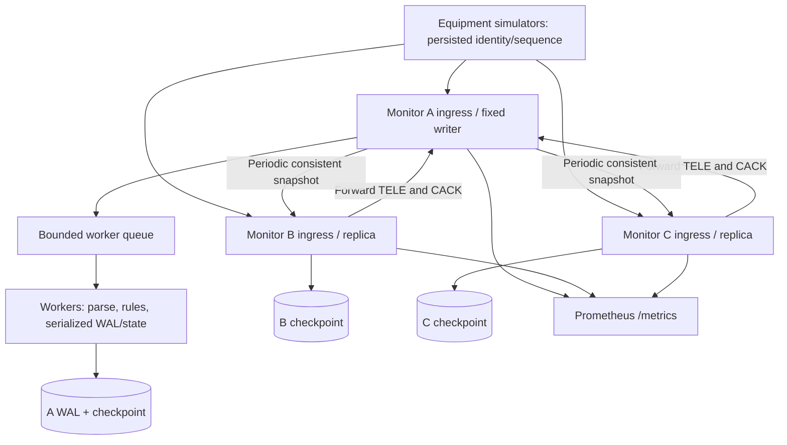

# Architecture and concurrency

The old design was one blocking network thread per device feeding one unbounded consumer. The new design is one socket-owning reactor, a fixed worker pool, one membership/replication thread, and bounded per-connection buffers. Each node is an independently restartable process. Node IDs label observability; configured peer endpoints identify membership targets. Authority is configured separately from membership.

Linux uses level-triggered epoll with explicit ADD/MOD/DEL. macOS uses poll over the same state machine. Only the reactor accepts, reads, writes, modifies registrations, or closes accepted sockets. Work carries a monotonic 64-bit connection token, never a reusable descriptor. Completions for disconnected tokens are discarded. One request per connection is in flight; coalesced frames wait in the input buffer. Partial writes retain an offset. EINTR/EAGAIN are retried safely; disconnects close through one ownership path.

All disk writes, expensive parsing, membership RPCs, and alert logs execute outside the reactor. Workers never wait for outbound bytes to drain: they publish a bounded completion and the reactor manages slow receivers. Default 30s idle timeout covers inactivity, including a job exceeding that deadline; such jobs can still commit, and the client must retry. It is not an absolute wall-clock lifetime for a continuously trickling connection. DNS resolution for worker/background outbound RPCs uses getaddrinfo and can exceed the TCP deadline; use numeric endpoints for deterministic latency tests.

Default limits: 4 workers, queue 256 jobs, 4,096 accepted connections, 4,096-byte input buffers, one response per connection, 16 MiB aggregate queued response budget, 4 MiB maximum snapshot, 10,000 persisted device identities. In-flight response construction is additionally bounded by worker count. OS socket buffers, the background snapshot, storage maps, and allocator overhead are additional memory. Memory is bounded by configuration; this is not a claim that the largest allowed configuration fits a 256 MiB container.

When the worker queue is full, retain the complete input frame and disable reads on that connection until admission succeeds. The device's stop-and-wait sender stalls and TCP applies backpressure. No queue entry is silently discarded. A frame above the maximum, an idle timeout, exhausted connection limit, or response-budget overflow can close/refuse a session; the client retries its same event. The response budget returns RETRY if it cannot retain a response; the mutation may already have committed. Admission scans connection order and has no strict fairness guarantee. Monitor queue depth and client tail latency.

The pool uses a mutex/condition variable and drains accepted jobs on stop. Signal handlers only set sig_atomic_t. Shutdown stops admission, joins membership/replication, drains and joins workers, then closes sockets. Responses can be lost during shutdown even though accepted writes persisted. Pending frames not admitted have no ACK promise. Worker lifetime ends before shared completion/state objects are destroyed.

Store's mutex defines one lock order and protects per-device state, WAL ordering, checkpoints, snapshots, and reads. Per-node metrics are atomic; completion bookkeeping has a separate mutex. No detached threads or unmanaged raw heap ownership exist in the active build. Global mutable state is limited to signal flags and the logging mutex. The load generator intentionally uses one client thread per simulated device; that choice does not affect server connection scaling.

Protocol is trusted-network newline text. TELE: `TELE device seq temperature pressure rpm RUNNING|WARNING|STOPPED [xxx padding]`. Normal reply: `ACK device current_seq command`. Other requests: `PING`, `STATE device`, `SNAPSHOT` (leader only), `CACK device seq`, `FAILOVER device`; metrics and health accept HTTP GET on the same port. This is a minimal HTTP subset, closes each HTTP request, and does not implement HTTP keep-alive or general request routing. `/health` checks process responsiveness, not leader write availability. No TLS, authentication, authorization, fencing, or encryption is implemented; bind/expose only on a trusted network. Compose publishes host ports on loopback.
